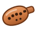
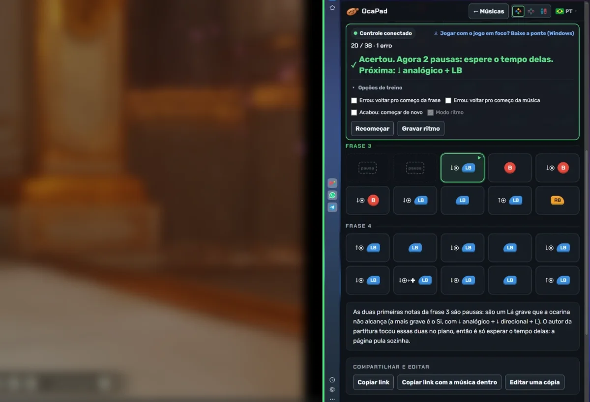

  

<h1 align="center">OcaPad</h1>

<a href="README.md">English</a> · <a href="README.pt-BR.md">Português</a> · <b>Español</b> · <a href="README.zh.md">中文</a> · <a href="README.ja.md">日本語</a>

  <b>Canciones para tocar en la ocarina con el mando, revisadas nota por nota.</b> 
  Anime, películas, videojuegos y la serie The Legend of Zelda, con botones de Xbox, PlayStation o Switch.

  🌐 <a href="https://oca-pad.github.io/"><b>Abrir el sitio</b></a>
  &nbsp;·&nbsp; 🎵 <a href="https://oca-pad.github.io/criar.html">Crear una canción</a>
  &nbsp;·&nbsp; ⬇️ <a href="../../releases/latest">Descargar el Puente del mando</a>

---

## 💡 La idea

En el remake de *Ocarina of Time*, la ocarina se toca con botones. La comunidad comparte "partituras" de canciones famosas escritas con esos botones, pero solo como imagen, y quien toca no sabe si acertó.

**OcaPad** convierte esas partituras en algo que se puede tocar y practicar:

- cada canción es una secuencia de botones, ya en el mando que usas;
- el sitio **lee tu mando** y marca cada nota como acierto ✓ o fallo ✗;
- cualquiera puede **crear una canción tocándola en su propio mando** y compartirla con un enlace.

Es gratis, funciona en el navegador y no necesita cuenta para tocar.

   
  El juego a un lado y OcaPad al otro: cada nota correcta se pone verde.

## ✨ Qué puedes hacer

| Función | Cómo funciona |
|---|---|
| 🎮 **Tocar y practicar** | Elige la canción, conecta el mando y toca. El sitio te dice qué pulsaste y qué tocaba. |
| 🔄 **Xbox, PlayStation o Switch** | Los botones aparecen con el dibujo de tu mando. Las canciones se guardan una vez y se convierten al momento. |
| ⏱️ **Modo ritmo** | Graba el tiempo tocando junto con un video. Luego una barra muestra cuándo tocar cada nota: *a tiempo*, *adelantado* o *atrasado*. |
| ✍️ **Crear canción** | Toca en el mando y la página escribe las notas y el ritmo. Después ajusta nota por nota. |
| 🔗 **Compartir por enlace** | La canción entera va dentro del enlace, sin publicar. El autor decide si otros pueden editar una copia, y la copia mantiene el crédito. |
| 📨 **Pedir publicación** | Un clic abre una solicitud ya rellenada en GitHub; una vez aprobada, la canción entra en la lista. |
| 🔎 **Búsqueda** | Por nombre, obra, categoría y dificultad, sin acentos ni mayúsculas. |
| 🌍 **5 idiomas** | Português, English, Español, 中文 y 日本語, según el idioma del navegador. |

## 🎼 Cómo leer una nota

Cada nota muestra **primero lo que mantienes y después el botón**, en el orden en que lo haces:

| En pantalla | Qué hacer |
|---|---|
| `B` | Pulsar solo el botón |
| `↓◉ + B` | Mantener la palanca izquierda abajo y pulsar el botón |
| `↑◉ + LB` | Mantener la palanca arriba y pulsar el botón |
| `↓◉ + ✚ + LB` | Mantener la palanca y la cruceta abajo y pulsar el botón |
| `pausa` | Nota que la ocarina no alcanza: solo espera, el sitio la salta |

## 🖥️ ¿Juegas en PC? Usa el Puente del mando

El navegador solo lee el mando mientras la ventana del sitio está seleccionada. Cuando haces clic en el juego, el sitio deja de ver los botones.

El **Puente del mando** es un programa pequeño para Windows (19 KB) que lee el mando directamente del sistema, como el emulador, y pasa los botones al sitio. Así las notas se revisan **con el juego en primer plano**.

1. Descarga `ponte-controle.exe` en [Releases](../../releases/latest) y ábrelo.
2. Abre OcaPad: en la barra de práctica aparece **"Puente conectado"**.
3. Haz clic en el juego y toca.

> 🔒 El puente no usa internet: solo se comunica con tu equipo y solo acepta el sitio OcaPad. Como no tiene firma digital, Windows puede avisar "Windows protegió su PC". Haz clic en **Más información → Ejecutar de todas formas**. El código está en [`ponte-controle/Ponte.cs`](ponte-controle/Ponte.cs).

Funciona con mandos que Windows ve como Xbox (PlayStation y Switch Pro con DS4Windows o Steam).

## 📨 Enviar una canción

1. En el sitio, abre **Crear canción**, graba y ajusta.
2. Haz clic en **Probar** para verla como la verán los demás.
3. Haz clic en **Pedir publicación**. Se abre una solicitud (*issue*) ya rellenada aquí en GitHub (necesitas una cuenta gratis).
4. Una vez aprobada, la canción aparece en la lista.

Para usarla sin publicar, basta con **Copiar enlace con la canción dentro**.

## ⚖️ Aviso

OcaPad es un **sitio de fans** gratuito, sin relación con Nintendo ni con ninguna empresa de videojuegos. *The Legend of Zelda* y *Nintendo* son marcas de Nintendo. El sitio solo muestra el orden de los botones, sin audio ni imágenes de los juegos, y los nombres de las obras pertenecen a sus dueños.

Para pedir que se retire una canción, [abre una solicitud aquí](../../issues/new?title=Solicitud%20de%20retirada).

Hecho con ♪ por quien disfruta tocar la ocarina con el mando.

