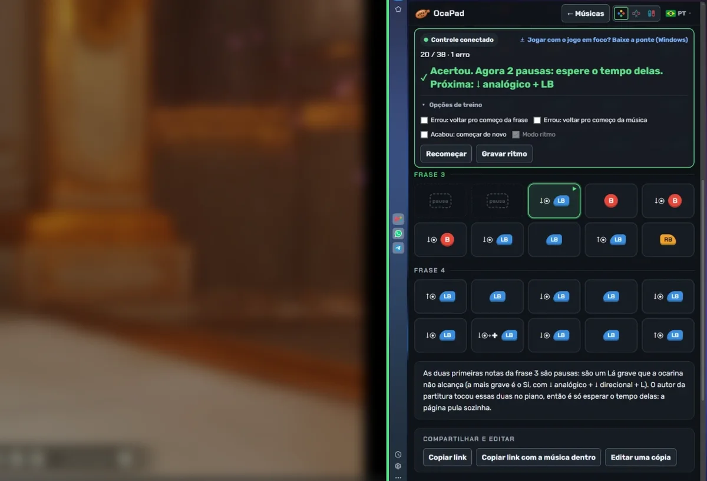

  

<h1 align="center">OcaPad</h1>

<a href="README.md">English</a> · <a href="README.pt-BR.md">Português</a> · <a href="README.es.md">Español</a> · <a href="README.zh.md">中文</a> · <b>日本語</b>

  <b>コントローラーでオカリナの曲を吹き、音をひとつずつチェック。</b> 
  アニメ・映画・ゲーム、そして「ゼルダの伝説」シリーズの曲を、Xbox・PlayStation・Switch のボタンで表示します。

  🌐 <a href="https://oca-pad.github.io/"><b>サイトを開く</b></a>
  &nbsp;·&nbsp; 🎵 <a href="https://oca-pad.github.io/criar.html">曲を作る</a>
  &nbsp;·&nbsp; ⬇️ <a href="../../releases/latest">コントローラーブリッジをダウンロード</a>

---

## 💡 アイデア

『時のオカリナ』のリメイク版では、オカリナをボタンで吹きます。コミュニティではボタンで書かれた有名曲の「楽譜」が共有されていますが、画像だけなので、正しく吹けたかどうかは分かりません。

**OcaPad** はその楽譜を、吹いて練習できるものに変えます。

- 曲はボタンの並びで表示され、使っているコントローラーに合わせて描かれます。
- サイトが**コントローラーを読み取り**、音ごとに正解 ✓ かミス ✗ を表示します。
- だれでも**自分のコントローラーで吹いて曲を作り**、リンクで共有できます。

無料・ブラウザで動作・演奏にアカウントは不要です。

   
  片側にゲーム、もう片側に OcaPad。正しい音は緑になります。

## ✨ できること

| 機能 | 内容 |
|---|---|
| 🎮 **演奏と練習** | 曲を選び、コントローラーをつないで吹きます。押したボタンと正しいボタンを教えてくれます。 |
| 🔄 **Xbox・PlayStation・Switch** | ボタンはあなたのコントローラーの絵で表示。曲は一度だけ保存され、その場で変換されます。 |
| ⏱️ **リズムモード** | 動画に合わせて吹いてリズムを録音。以後はバーが各音のタイミングを示し、*ぴったり*・*早い*・*遅い* を判定します。 |
| ✍️ **曲を作る** | コントローラーで吹くと、ページが音とリズムを書き取ります。あとは音ごとに調整。 |
| 🔗 **リンクで共有** | 曲全体がリンクに入るので、公開しなくても共有できます。作者はコピーの編集を許可するか選べ、コピーにはクレジットが残ります。 |
| 📨 **公開を依頼** | ワンクリックで GitHub に入力済みの依頼が開きます。承認されるとサイトの一覧に載ります。 |
| 🔎 **検索** | 曲名・作品・カテゴリ・難易度で検索できます。 |
| 🌍 **5 言語** | Português・English・Español・中文・日本語。ブラウザの言語で自動選択。 |

## 🎼 音の読み方

各音は**先に押さえるもの、次にボタン**の順で表示されます。

| 画面 | 操作 |
|---|---|
| `B` | ボタンだけを押す |
| `↓◉ + B` | 左スティックを下に倒したままボタンを押す |
| `↑◉ + LB` | 左スティックを上に倒したままボタンを押す |
| `↓◉ + ✚ + LB` | 左スティックと十字キーを下にしたままボタンを押す |
| `休符` | オカリナで出せない音。待つだけで、サイトが自動で飛ばします |

## 🖥️ PC で遊ぶならコントローラーブリッジ

ブラウザは、サイトのウィンドウが選択されている間しかコントローラーを読めません。ゲームをクリックして吹き始めると、サイトはボタンを見られなくなります。

**コントローラーブリッジ**は小さな Windows 用プログラム（19 KB）です。エミュレーターと同じようにシステムから直接コントローラーを読み、ボタンをサイトに伝えます。**ゲームを操作中でも**音をチェックできます。

1. [Releases](../../releases/latest) から `ponte-controle.exe` をダウンロードして開きます。
2. OcaPad を開くと、練習バーに **「ブリッジ接続中」** と出ます。
3. ゲームをクリックして吹きます。

> 🔒 ブリッジはインターネットを使いません。あなたの PC の中だけで通信し、OcaPad のサイトだけを受け付けます。デジタル署名がないため「Windows によって PC が保護されました」と出ることがあります。**詳細情報 → 実行** を押してください。ソースは [`ponte-controle/Ponte.cs`](ponte-controle/Ponte.cs) にあります。

Windows が Xbox として認識するコントローラーで動きます（PlayStation・Switch Pro は DS4Windows や Steam 経由）。

## 📨 曲を投稿する

1. サイトで **曲を作る** を開き、録音して調整します。
2. **試す** で、ほかの人に見える形を確認します。
3. **サイトへの公開を依頼** を押すと、GitHub に入力済みの依頼（*issue*）が開きます（無料アカウントが必要）。
4. 承認されると、一覧に曲が表示されます。

公開せずに使うなら、**曲入りリンクをコピー** するだけで OK です。

## ⚖️ ご注意

OcaPad は無料の**ファンサイト**で、任天堂やゲーム会社とは関係ありません。「ゼルダの伝説」（The Legend of Zelda）および「Nintendo」は任天堂の商標です。サイトに載せているのはボタンの順番だけで、ゲームの音声や画像は含みません。作品名は各権利者に帰属します。

曲の削除依頼は[こちらから](../../issues/new?title=Removal%20request)どうぞ。

コントローラーでオカリナを吹くのが好きな人が ♪ で作りました。

