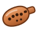
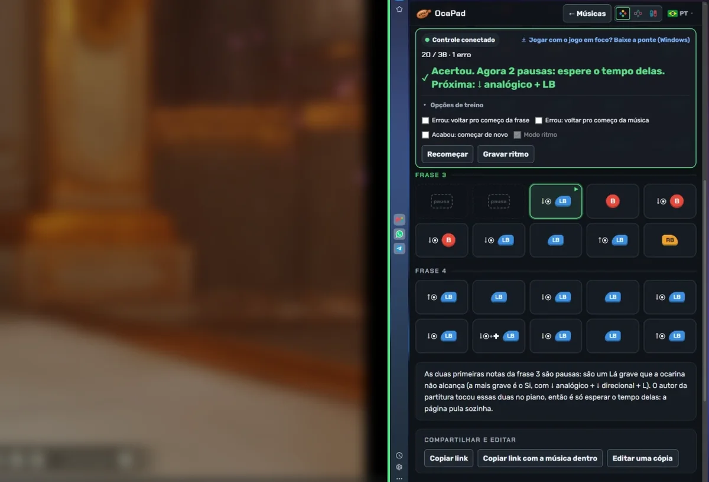

<p align="center">
  
</p>

<h1 align="center">OcaPad</h1>

<p align="center"><b>English</b> · <a href="README.pt-BR.md">Português</a></p>

<p align="center">
  <b>Songs to play on the ocarina with your controller, checked note by note.</b><br>
  Anime, movies, games and The Legend of Zelda series, shown as Xbox, PlayStation or Switch buttons.
</p>

<p align="center">
  🌐 <a href="https://oca-pad.github.io/"><b>Open the site</b></a>
  &nbsp;·&nbsp; 🎵 <a href="https://oca-pad.github.io/criar.html">Create a song</a>
  &nbsp;·&nbsp; ⬇️ <a href="../../releases/latest">Download the Controller Bridge</a>
</p>

---

## 💡 The idea

In the *Ocarina of Time* remake, the ocarina is played with buttons. The community shares "sheets" of famous songs written with those buttons, but only as images, so players can't tell whether they hit the right notes.

**OcaPad** turns those sheets into something you can play and practice:

- each song is a sequence of buttons, shown for the controller you use;
- the site **reads your controller** and marks every note right ✓ or wrong ✗;
- anyone can **create a song by playing it on their own controller** and share it with a link.

It's free, runs in the browser and needs no account to play.

<p align="center">
  <br>
  <sub>The game on one side and OcaPad on the other: every right note turns green.</sub>
</p>

## ✨ What you can do

| Feature | How it works |
|---|---|
| 🎮 **Play and practice** | Pick a song, connect your controller and play. The site tells you what you pressed and what it should have been. |
| 🔄 **Xbox, PlayStation or Switch** | Buttons are drawn for your controller. Songs are stored once and converted on the fly. |
| ⏱️ **Rhythm mode** | Record the timing while playing along with a video. Then a bar shows when to play each note: *on time*, *early* or *late*. |
| ✍️ **Create a song** | Play on your controller and the page writes down the notes and the rhythm. Then fine-tune note by note. |
| 🔗 **Share by link** | The whole song fits inside the link, no publishing needed. The author decides whether others may edit a copy, and copies keep the credit. |
| 📨 **Request publishing** | One click opens a pre-filled request on GitHub; once approved, the song joins the site's list. |
| 🔎 **Search** | By name, source, category and difficulty, ignoring accents and capitals. |
| 🌍 **5 languages** | Português, English, Español, 中文 and 日本語, picked from your browser language. |

## 🎼 How to read a note

Each note shows **what to hold first, then the button**, in the order you do it:

| On screen | What to do |
|---|---|
| `B` | Press only the button |
| `↓◉ + B` | Hold the left stick down and press the button |
| `↑◉ + LB` | Hold the left stick up and press the button |
| `↓◉ + ✚ + LB` | Hold the left stick and the D-pad down and press the button |
| `rest` | A note the ocarina can't reach: just wait, the site skips it |

## 🖥️ Playing on PC? Use the Controller Bridge

Browsers only read the controller while the site's window is selected. When you click the game, the site stops seeing the buttons.

The **Controller Bridge** is a tiny Windows program (19 KB) that reads the controller straight from the system, like the emulator does, and passes the buttons to the site. Notes are checked **while the game has focus**.

1. Download `ponte-controle.exe` from [Releases](../../releases/latest) and open it.
2. Open OcaPad: the practice bar shows **"Bridge connected"**.
3. Click the game and play.

> 🔒 The bridge doesn't use the internet: it only talks to your own computer and only accepts the OcaPad site. Since it isn't digitally signed, Windows may say "Windows protected your PC". Click **More info → Run anyway**. The source is in [`ponte-controle/Ponte.cs`](ponte-controle/Ponte.cs).

Works with controllers Windows sees as Xbox (PlayStation and Switch Pro through DS4Windows or Steam).

## 📨 Submit a song

1. On the site, open **Create a song**, record and adjust.
2. Click **Test** to see it the way others will.
3. Click **Request publishing**. A pre-filled request (*issue*) opens here on GitHub (a free account is needed).
4. Once approved, the song shows up in the list.

To use a song without publishing it, just **Copy the link with the song inside**.

## 🗂️ Project layout

```
├── index.html, tocar.html, criar.html   the three pages (list, play, create)
├── musicas/                             one .json file per song
├── js/                                  logic (search, controller reading, languages…)
├── css/  img/                           styles, logo and images
├── scripts/                             builds the song list and approves requests
├── ponte-controle/                      Controller Bridge source (Windows)
└── .github/workflows/                   automatic publishing, approval and .exe build
```

- Each song is a small file in [`musicas/`](musicas/). The format is described in [COMO-PUBLICAR.md](COMO-PUBLICAR.md) (Portuguese).
- On every change, an automation builds the song list and publishes the site on GitHub Pages.
- To approve a song request, add the **`aprovada`** label to the issue.

**To run it on your PC:** double-click `abrir-site.bat` (requires [Node.js](https://nodejs.org)).

## ⚖️ Notice

OcaPad is a free **fan site**, not affiliated with Nintendo or any game company. *The Legend of Zelda* and *Nintendo* are trademarks of Nintendo. The site only shows button orders, with no audio or images from the games, and the names of works belong to their owners.

To request the removal of a song, [open a request here](../../issues/new?title=Removal%20request).

<p align="center"><sub>Made with ♪ by people who like playing the ocarina with a controller.</sub></p>
