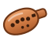
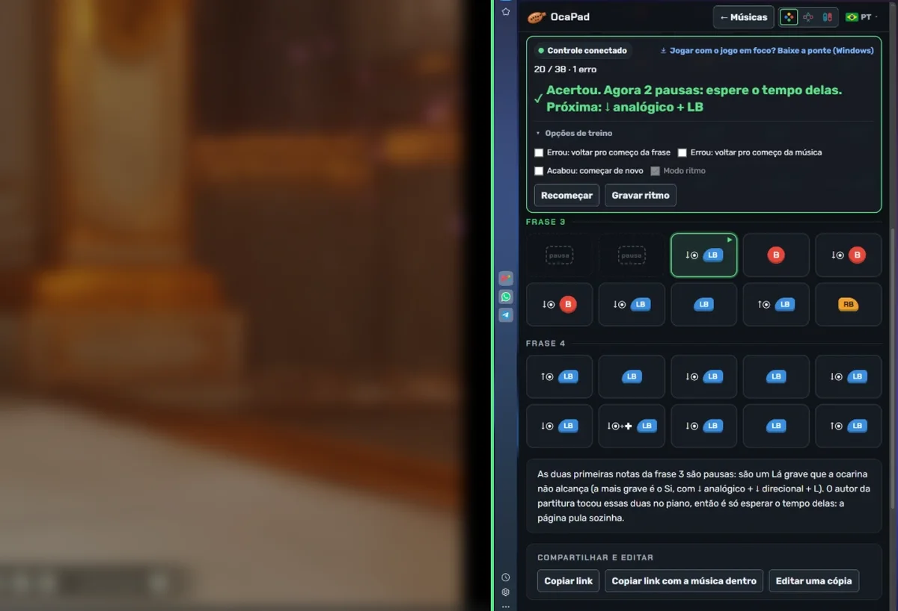

<p align="center">
  
</p>

<h1 align="center">OcaPad</h1>

<p align="center"><a href="README.md">English</a> · <b>Português</b></p>

<p align="center">
  <b>Músicas para tocar na ocarina com o controle, conferindo nota por nota.</b><br>
  Anime, filmes, jogos e a série The Legend of Zelda, em botões do Xbox, PlayStation ou Switch.
</p>

<p align="center">
  🌐 <a href="https://oca-pad.github.io/"><b>Abrir o site</b></a>
  &nbsp;·&nbsp; 🎵 <a href="https://oca-pad.github.io/criar.html">Criar uma música</a>
  &nbsp;·&nbsp; ⬇️ <a href="../../releases/latest">Baixar a Ponte do controle</a>
</p>

---

## 💡 A ideia

No remake de *Ocarina of Time*, a ocarina é tocada com botões. A comunidade compartilha "partituras" de músicas famosas escritas com esses botões, mas só como imagem, e quem toca não tem como saber se acertou.

O **OcaPad** transforma essas partituras em algo que se pode tocar e treinar:

- a música aparece como uma sequência de botões, já no controle que você usa;
- o site **lê o seu controle** e mostra cada nota como acerto ✓ ou erro ✗;
- qualquer pessoa pode **criar uma música tocando no próprio controle** e compartilhar por link.

Tudo é gratuito, roda no navegador e não precisa de conta para tocar.

<p align="center">
  <br>
  <sub>O jogo de um lado e o OcaPad do outro: cada nota certa fica verde.</sub>
</p>

## ✨ O que dá para fazer

| Função | Como funciona |
|---|---|
| 🎮 **Tocar e treinar** | Escolha a música, conecte o controle e toque. O site avisa o que você apertou e o que era para apertar. |
| 🔄 **Xbox, PlayStation ou Switch** | Os botões aparecem no desenho do seu controle. As músicas são guardadas uma vez só e convertidas na hora. |
| ⏱️ **Modo ritmo** | Grave o tempo tocando junto com o vídeo. Depois uma barra mostra a hora de cada nota: *no tempo*, *adiantado* ou *atrasado*. |
| ✍️ **Criar música** | Toque no controle e a página escreve as notas e o ritmo. Depois é só ajustar nota por nota. |
| 🔗 **Compartilhar por link** | A música inteira vai dentro do link, sem precisar publicar. O autor escolhe se outras pessoas podem editar uma cópia, e a cópia mantém o crédito. |
| 📨 **Pedir publicação** | Um clique abre um pedido no GitHub; depois de aprovada, a música entra na lista do site. |
| 🔎 **Busca** | Por nome, obra, categoria e dificuldade, sem acentos e sem maiúsculas. |
| 🌍 **5 idiomas** | Português, English, Español, 中文 e 日本語, escolhidos pelo idioma do navegador. |

## 🎼 Como ler uma nota

Cada nota mostra **primeiro o que segurar e depois o botão**, na ordem em que você faz:

| Na tela | O que fazer |
|---|---|
| `B` | Apertar só o botão |
| `↓◉ + B` | Segurar o analógico esquerdo para baixo e apertar o botão |
| `↑◉ + LB` | Segurar o analógico para cima e apertar o botão |
| `↓◉ + ✚ + LB` | Segurar o analógico e o direcional para baixo e apertar o botão |
| `pausa` | Nota que a ocarina não alcança: é só esperar, o site pula sozinho |

## 🖥️ Jogando no PC? Use a Ponte do controle

O navegador só lê o controle enquanto a janela do site está selecionada. Quando você clica no jogo, o site para de ver os botões.

A **Ponte do controle** é um programinha para Windows (19 KB) que lê o controle direto do sistema, como o emulador faz, e repassa os botões ao site. Assim as notas são conferidas **com o jogo em foco**.

1. Baixe o `ponte-controle.exe` na página [Releases](../../releases/latest) e abra.
2. Abra o OcaPad: na barra de treino aparece **"Ponte conectada"**.
3. Clique no jogo e toque.

> 🔒 A ponte não usa a internet: só conversa com o seu computador e só aceita o site OcaPad. Como não tem assinatura digital, o Windows pode avisar "O Windows protegeu o computador". Clique em **Mais informações → Executar assim mesmo**. O código está em [`ponte-controle/Ponte.cs`](ponte-controle/Ponte.cs).

Funciona com controles que o Windows vê como Xbox (o de PlayStation e o Pro do Switch via DS4Windows ou Steam).

## 📨 Enviar uma música

1. No site, abra **Criar música**, grave e ajuste.
2. Clique em **Testar** para ver como os outros vão ver.
3. Clique em **Pedir publicação no site**. Abre um pedido (*issue*) já preenchido aqui no GitHub (precisa de uma conta grátis).
4. Depois de aprovada, a música aparece na lista.

Para usar sem publicar, basta **Copiar link com a música dentro**.

## 🗂️ Como o projeto é organizado

```
ocapad/
├── index.html, tocar.html, criar.html   as três páginas
├── musicas/                             um arquivo .json por música
├── js/                                  funcionamento (busca, leitura do controle, idiomas…)
├── css/  img/                           aparência, logo e imagens
├── scripts/                             gera a lista de músicas e aprova pedidos
├── ponte-controle/                      código da Ponte do controle (Windows)
└── .github/workflows/                   publicação automática, aprovação e geração do .exe
```

- Cada música é um arquivo simples em [`musicas/`](musicas/). O formato está explicado em [COMO-PUBLICAR.md](COMO-PUBLICAR.md#adicionar-uma-música).
- A cada mudança, uma automação gera a lista de músicas e publica o site no GitHub Pages.
- Para aprovar um pedido de música, basta colocar a etiqueta **`aprovada`** na issue.

**Para ver no seu PC:** dê dois cliques em `abrir-site.bat` (precisa do [Node.js](https://nodejs.org)).

Os detalhes de publicação, aprovação e ponte estão em **[COMO-PUBLICAR.md](COMO-PUBLICAR.md)**.

## ⚖️ Aviso

O OcaPad é um **site de fãs**, gratuito e sem ligação com a Nintendo ou com qualquer empresa de jogos. *The Legend of Zelda* e *Nintendo* são marcas da Nintendo. O site mostra só a ordem dos botões, sem áudio nem imagens dos jogos, e os nomes das obras pertencem aos seus donos.

Para pedir a remoção de alguma música, [abra um pedido aqui](../../issues/new?title=Pedido%20de%20remo%C3%A7%C3%A3o).

<p align="center"><sub>Feito com ♪ por quem gosta de tocar ocarina com o controle.</sub></p>
