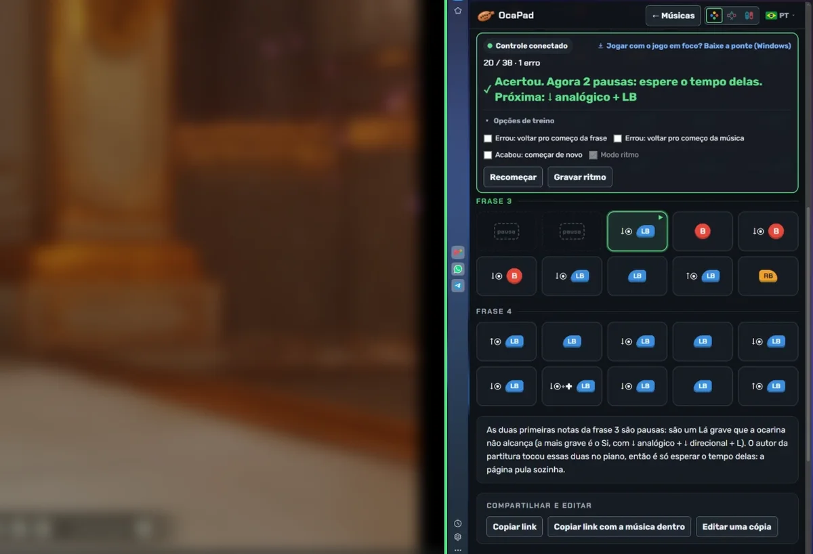

  

<h1 align="center">OcaPad</h1>

<a href="README.md">English</a> · <a href="README.pt-BR.md">Português</a> · <a href="README.es.md">Español</a> · <b>中文</b> · <a href="README.ja.md">日本語</a>

  <b>用手柄演奏陶笛乐曲，逐个检查每个音。</b> 
  动漫、电影、游戏和《塞尔达传说》系列，以 Xbox、PlayStation 或 Switch 按键显示。

  🌐 <a href="https://oca-pad.github.io/"><b>打开网站</b></a>
  &nbsp;·&nbsp; 🎵 <a href="https://oca-pad.github.io/criar.html">创建乐曲</a>
  &nbsp;·&nbsp; ⬇️ <a href="../../releases/latest">下载手柄桥接</a>

---

## 💡 想法

在《时之笛》重制版中，陶笛是用按键演奏的。玩家们会分享用这些按键写成的名曲“乐谱”，但只是图片，演奏的人无法知道自己有没有按对。

**OcaPad** 把这些乐谱变成可以演奏和练习的东西：

- 每首乐曲都是一串按键，并按你使用的手柄显示；
- 网站会**读取你的手柄**，把每个音标记为正确 ✓ 或错误 ✗；
- 任何人都可以**用自己的手柄弹奏来创建乐曲**，并通过链接分享。

完全免费，在浏览器中运行，演奏无需注册账号。

   
  一边是游戏，一边是 OcaPad：每个正确的音都会变绿。

## ✨ 功能

| 功能 | 说明 |
|---|---|
| 🎮 **演奏与练习** | 选择乐曲，连接手柄并演奏。网站会告诉你按了什么、应该按什么。 |
| 🔄 **Xbox、PlayStation 或 Switch** | 按键以你的手柄样式显示。乐曲只保存一次，实时转换。 |
| ⏱️ **节奏模式** | 跟着视频演奏并录制节奏。之后进度条会提示每个音的时机：*准时*、*提前* 或 *延后*。 |
| ✍️ **创建乐曲** | 用手柄弹奏，页面会记下音符和节奏，之后逐个微调。 |
| 🔗 **链接分享** | 整首乐曲都在链接里，无需发布。作者可以决定是否允许他人编辑副本，副本会保留署名。 |
| 📨 **申请发布** | 一键在 GitHub 打开已填好的申请；审核通过后，乐曲会加入网站列表。 |
| 🔎 **搜索** | 按名称、出处、分类和难度搜索。 |
| 🌍 **5 种语言** | Português、English、Español、中文 和 日本語，根据浏览器语言自动选择。 |

## 🎼 如何看音符

每个音先显示**要按住的东西，再显示按键**，按操作顺序排列：

| 屏幕显示 | 操作 |
|---|---|
| `B` | 只按这个键 |
| `↓◉ + B` | 按住左摇杆向下，再按键 |
| `↑◉ + LB` | 按住左摇杆向上，再按键 |
| `↓◉ + ✚ + LB` | 按住左摇杆和十字键向下，再按键 |
| `休止` | 陶笛够不到的音：等待即可，网站会自动跳过 |

## 🖥️ 在电脑上玩？使用手柄桥接

浏览器只有在网站窗口被选中时才能读取手柄。当你点击游戏开始演奏时，网站就看不到按键了。

**手柄桥接**是一个很小的 Windows 程序（19 KB），像模拟器一样直接从系统读取手柄，再把按键传给网站。这样即使**游戏在前台**，也能检查音符。

1. 在 [Releases](../../releases/latest) 下载并打开 `ponte-controle.exe`。
2. 打开 OcaPad：练习栏会显示 **“桥接已连接”**。
3. 点击游戏并演奏。

> 🔒 桥接不使用互联网：只与你自己的电脑通信，并且只接受 OcaPad 网站。由于没有数字签名，Windows 可能提示“Windows 已保护你的电脑”，请点击 **更多信息 → 仍要运行**。源代码见 [`ponte-controle/Ponte.cs`](ponte-controle/Ponte.cs)。

支持 Windows 识别为 Xbox 的手柄（PlayStation 和 Switch Pro 可通过 DS4Windows 或 Steam）。

## 📨 提交乐曲

1. 在网站上打开 **创建乐曲**，录制并调整。
2. 点击 **测试**，看看别人看到的样子。
3. 点击 **申请发布**，会在 GitHub 打开已填好的申请（*issue*，需要免费账号）。
4. 审核通过后，乐曲就会出现在列表中。

如果不想发布，只需 **复制包含乐曲的链接**。

## ⚖️ 声明

OcaPad 是免费的**粉丝网站**，与任天堂及任何游戏公司无关。*The Legend of Zelda*（塞尔达传说）和 *Nintendo* 是任天堂的商标。网站只显示按键顺序，不含游戏的音频或图像，作品名称归其所有者所有。

如需删除某首乐曲，请[在此提交请求](../../issues/new?title=Removal%20request)。

由喜欢用手柄吹陶笛的人用 ♪ 制作。

